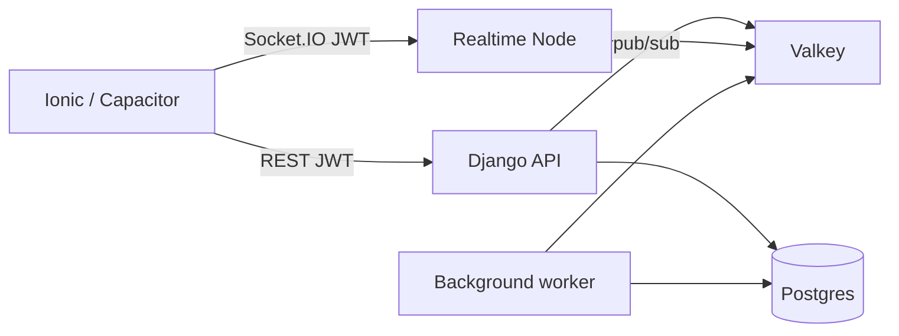

# iSpan Architecture

Standalone marketplace for informal trades in South Africa (Cape Town launch). British/South African English in product copy.

## Stack

| Layer | Choice |
|---|---|
| API | Django 5 + DRF + SimpleJWT |
| Realtime | Node.js (LTS) + Socket.IO |
| Client | Ionic + Angular standalone + Capacitor (+ light PWA) |
| Data | PostgreSQL (haversine geo for MVP; PostGIS optional later) |
| Cache / broker | Valkey / Redis-compatible Key Value |
| Hosting | **Render, Frankfurt** |

## Services



- **Django** owns all durable state (jobs, money, consent, verification).
- **Realtime** fans out offers, GPS, chat and SOS. It is not the source of truth.
- On conflict, **Django wins**.

## Auth

The same JWT signing secret (`JWT_SIGNING_KEY`) authenticates REST and Socket.IO connections.

## Geo

MVP uses latitude/longitude decimals plus a haversine distance helper with a bounding-box prefilter. The geo helper is designed so PostGIS can be enabled later without rewriting public APIs.

## Render free-tier limits (MVP)

Free web services **spin down** after inactivity (cold starts). Free Postgres has storage and **expiry** limits. Bandwidth and compute hours are capped. There is no GPU. A production launch will likely need paid instances. Local development does not require paid Render plans.

## POPIA hosting note

Production hosting is planned on Render in the **Frankfurt** region. Cross-border transfer wording for personal information must be approved by counsel (`[cross-border transfer clause]` in the privacy notice).

## Local boot

```bash
make up          # Postgres + Valkey
make migrate
./scripts/dev-up.sh   # or: make dev
```

- App: http://localhost:8100/
- API: http://localhost:8001/healthz
- Realtime: http://localhost:4000/healthz
